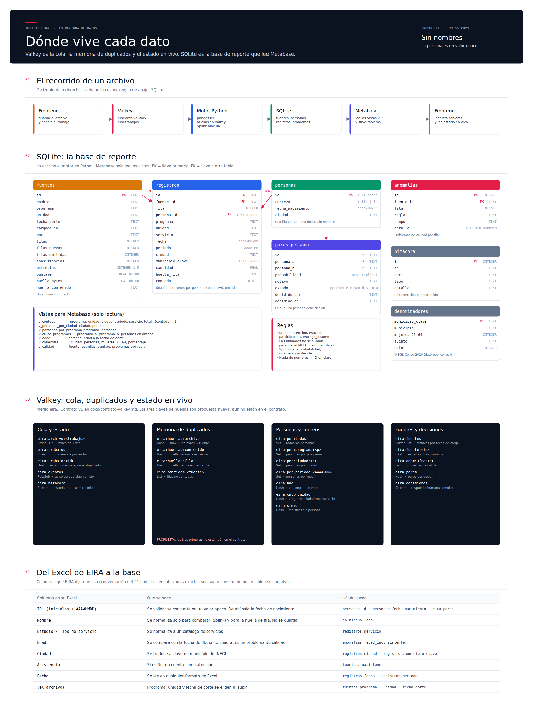
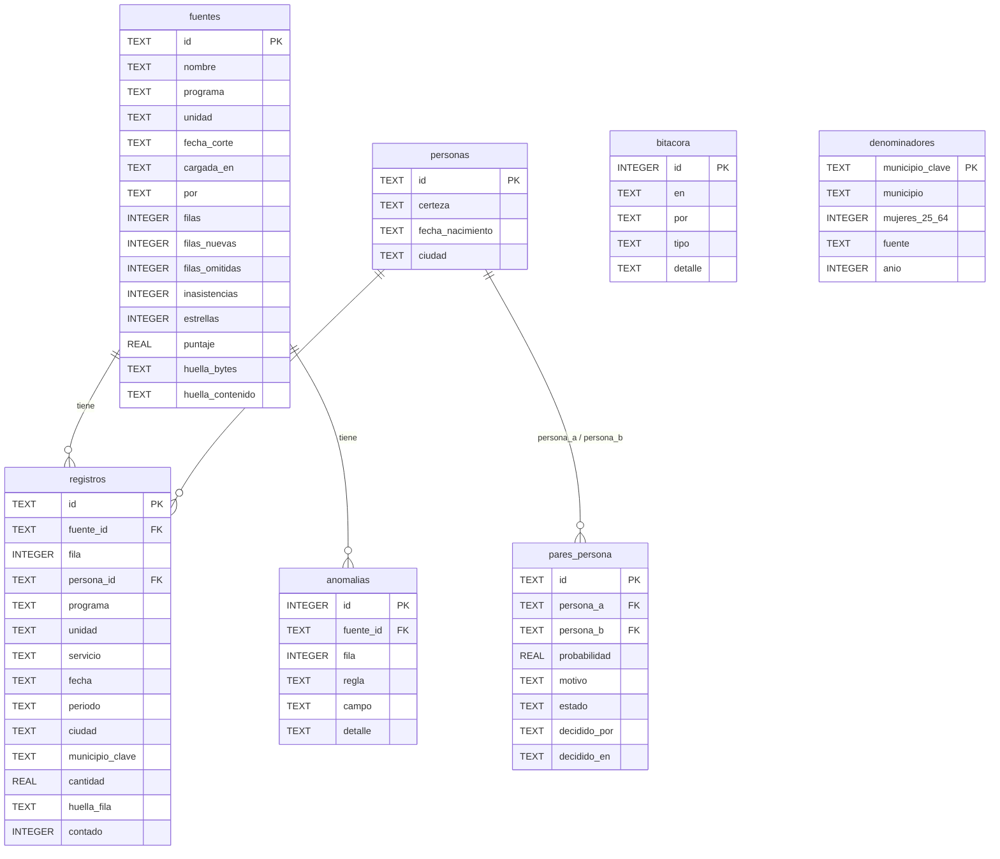

# Estructura de datos (propuesta)

Editable: [`base-de-datos.excalidraw`](base-de-datos.excalidraw). Es una **propuesta**: todavía no existe la base ni hay código que la use. El contrato de Valkey vigente es [`contrato-valkey.md`](contrato-valkey.md).

## Reparto

| Pieza | Papel | Quién escribe | Quién lee |
|---|---|---|---|
| Valkey | Cola de archivos, memoria de duplicados, estado en vivo | Frontend y motor | Frontend y motor |
| SQLite (`data/impacto.sqlite`) | Base de reporte | Motor en Python | Metabase |
| DuckDB | Motor interno de Splink | — | — |
| Metabase | Tableros | — | Frontend (incrustados) |

## SQLite

Reglas:

- `registros`: una fila por evento por persona. `persona_id` nulo significa "sin identificar". `contado = 0` es una fila omitida por repetida; se conserva para poder restituirla.
- `unidad` ∈ `atencion`, `estudio`, `participacion`, `entrega_insumo`. Las unidades no se suman entre sí.
- `personas.id` es un valor opaco. No se guarda el nombre ni el ID de EIRA en claro.
- `pares_persona.probabilidad` la da Splink; `estado` lo decide una persona.
- `fuentes.huella_bytes` es única: impide registrar dos veces el mismo archivo.

Vistas que lee Metabase: `v_conteos`, `v_personas_por_ciudad`, `v_personas_por_programa`, `v_cruce_programas`, `v_edad`, `v_cobertura`, `v_calidad`. El SQL completo de tablas y la definición de cada vista están en la Tarea 1 de [`superpowers/plans/2026-11-21-demo-integrado.md`](superpowers/plans/2026-11-21-demo-integrado.md).

## Programas e iniciativas (actualización 13:00)

EIRA no tiene solo "programas" de atención: tiene iniciativas de otra naturaleza, como la recolección de cabello (Melenas en Movimiento) o "Me cuidan mientras aprendo". No todas producen atenciones ni todas tienen beneficiarias en el mismo sentido. La base lo modela con catálogos en lugar de una lista fija:

| Tabla nueva | Columnas | Para qué |
|---|---|---|
| `iniciativas` | `id`, `nombre`, `clase` (`programa` o `iniciativa`), `descripcion`, `rol_por_defecto`, `estado` (`confirmado` o `por_confirmar`) | Cada programa o iniciativa de EIRA |
| `tipos_de_registro` | `clave`, `etiqueta`, `plural`, `se_cuenta` (`eventos` u `objetos`), `cuenta_personas` (0 o 1) | Qué clase de cosa es una fila: atención, estudio, participación, entrega de insumo, donación recibida, producto entregado |
| `iniciativa_tipo` | `iniciativa_id`, `tipo_clave` | Qué tipos de registro admite cada iniciativa |

Cambios en tablas existentes:

- `fuentes.programa` pasa a ser `fuentes.iniciativa_id` (llave a `iniciativas`).
- `registros.programa` pasa a ser `registros.iniciativa_id`; `registros.unidad` pasa a ser `registros.tipo_registro` (llave a `tipos_de_registro`, ya no una lista cerrada de cuatro valores).
- `registros.rol_persona` nuevo: `beneficiaria`, `participante`, `donante` o `voluntaria`.

Por qué importa el rol: quien dona una trenza no es una persona "impactada"; quien recibe una peluca sí. Si se contaran igual, el número de personas impactadas del informe saldría inflado. Las vistas de personas (`v_personas_por_ciudad`, `v_personas_por_programa`, `v_edad`, `v_cobertura`) cuentan solo los roles `beneficiaria` y `participante`; las donantes y voluntarias se reportan aparte.

El catálogo inicial está en [`catalogos/iniciativas.json`](../catalogos/iniciativas.json) y es la única fuente para el frontend y el motor. "Me cuidan mientras aprendo" está marcada `por_confirmar`: sabemos que existe porque lo dijo el equipo, pero no qué registra.

En Valkey el campo `<programa>` de las claves pasa a llevar el `id` de la iniciativa (`eira:per:programa:<id>`, primer segmento de `eira:cnt:<tipo>`); el nombre de la clave no cambia para no romper lo ya construido.

> El diagrama de arriba todavía muestra el modelo anterior (columna `programa` y cuatro unidades fijas).

## Estado y municipio: trazabilidad territorial (actualización 13:15)

Cada registro guarda dónde ocurrió con las claves oficiales de INEGI, para poder seguirlo por estado y por municipio.

| Dónde | Columnas | Contenido |
|---|---|---|
| `registros` | `estado_clave`, `estado`, `municipio_clave`, `municipio` | Clave de entidad (2 dígitos) y de municipio (5 dígitos: entidad + municipio), con sus nombres oficiales. `ciudad` conserva el texto tal como venía en el Excel |
| Tabla nueva `municipios` | `clave`, `municipio`, `estado_clave`, `estado` | El catálogo completo del país: 2,478 municipios en 32 entidades. Fuente: INEGI, en `publicos/municipios_mexico.json` |
| Vista nueva `v_presencia` | `iniciativa_id`, `estado`, `municipios_con_actividad`, `municipios_del_estado`, `registros`, `personas` | Presencia por estado y programa |
| Vista nueva `v_presencia_municipios` | `iniciativa_id`, `estado`, `municipio_clave`, `municipio`, `registros`, `personas` | Solo los municipios con actividad |

Cómo se resuelve el lugar: el Excel trae "Ciudad"; al subir el archivo se indica el estado (por defecto Jalisco) y el motor busca la ciudad en el catálogo de ese estado, con alias para los nombres de uso común (Ciudad Guzmán es Zapotlán el Grande). Si el Excel trae una columna de estado, manda esa. Lo que no se pueda resolver queda como problema de calidad `ciudad_desconocida` y no se asigna a ningún municipio.

En Valkey, una clave nueva que escribe el motor: `eira:presencia:<alcance>` (Hash; `<alcance>` es el id del programa o `global`), con campo `<municipio_clave>` y valor el número de registros.

**Cómo se muestra.** Es un dato secundario, al final de la Vista previa y del informe, y se presenta como presencia, no como faltante: "Presencia en 6 municipios de 1 estado", con la lista de municipios y un mosaico discreto del estado donde cada municipio con actividad va marcado. El total del estado aparece solo como referencia en letra pequeña ("de 125 municipios de Jalisco"). No se muestran porcentajes de cobertura territorial, ni listas de municipios sin atender, ni colores de alerta.

## Valkey

Las claves del contrato v1 están en [`contrato-valkey.md`](contrato-valkey.md). **Propuesta de tres claves nuevas**, que el contrato aún no tiene y que el motor necesita para omitir duplicados:

| Clave | Tipo | Contenido |
|---|---|---|
| `eira:huellas:archivo` | Hash | sha256 de los bytes → id de fuente |
| `eira:huellas:contenido` | Hash | huella canónica del contenido → id de fuente |
| `eira:huellas:fila` | Hash | huella de fila → `<fuente>:<fila>` donde se contó |

Son internas del motor (el frontend no las lee), así que agregarlas no rompe nada.

## Del Excel de EIRA a la base

Columnas según la conversación con EIRA; los encabezados exactos son supuestos.

| Columna en su Excel | Qué se hace | Dónde queda |
|---|---|---|
| ID (iniciales + `AAAAMMDD`) | Se valida y se convierte en un valor opaco; de ahí sale la fecha de nacimiento | `personas.id`, `personas.fecha_nacimiento`, `eira:per:*` |
| Nombre | Se normaliza solo para comparar (Splink) y para la huella de fila | No se guarda |
| Estudio / Tipo de servicio | Se normaliza a un catálogo | `registros.servicio` |
| Edad | Se compara con la fecha del ID | `anomalias` si no cuadra |
| Ciudad | Se traduce a clave de municipio de INEGI | `registros.ciudad`, `registros.municipio_clave` |
| Asistencia | Si es "No", no cuenta | `fuentes.inasistencias` |
| Fecha | Se lee en cualquier formato de Excel | `registros.fecha`, `registros.periodo` |
| (el archivo) | Programa, unidad y fecha de corte se eligen al subir | `fuentes` |
