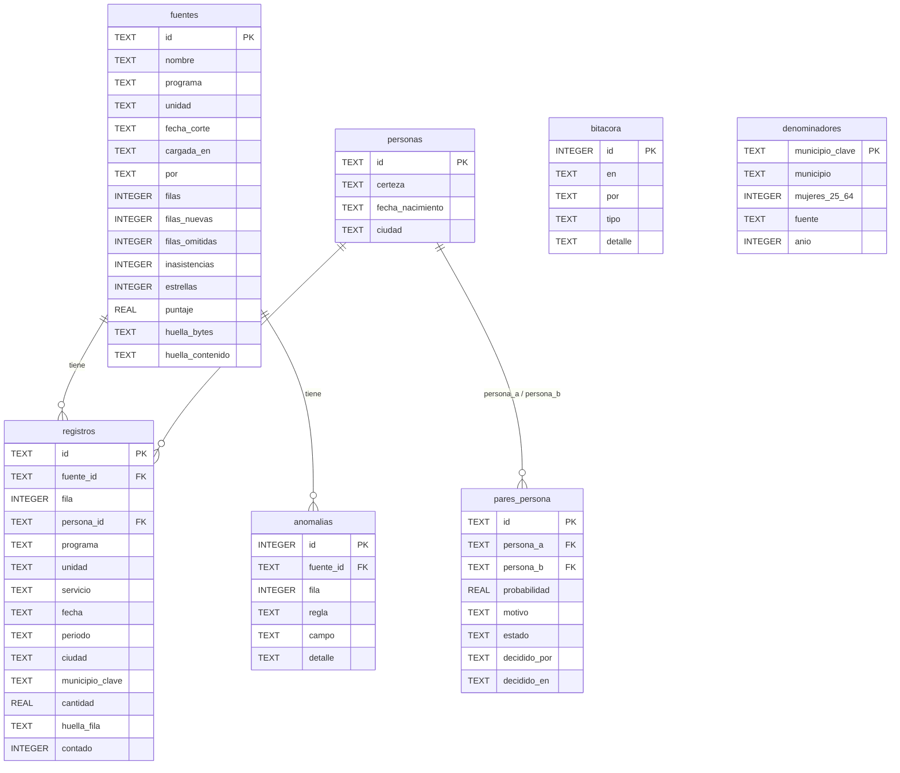

# Estructura de datos (propuesta)

Editable: [`base-de-datos.excalidraw`](base-de-datos.excalidraw). Es una **propuesta**: todavía no existe la base ni hay código que la use. El contrato de Valkey vigente es [`contrato-valkey.md`](contrato-valkey.md).

## Reparto

| Pieza | Papel | Quién escribe | Quién lee |
|---|---|---|---|
| Valkey | Cola de archivos, memoria de duplicados, estado en vivo | Frontend y motor | Frontend y motor |
| SQLite (`data/impacto.sqlite`) | Base de reporte | Motor en Python | Metabase |
| DuckDB | Motor interno de Splink | — | — |
| Metabase | Tableros | — | Frontend (incrustados) |

## SQLite

Reglas:

- `registros`: una fila por evento por persona. `persona_id` nulo significa "sin identificar". `contado = 0` es una fila omitida por repetida; se conserva para poder restituirla.
- `unidad` ∈ `atencion`, `estudio`, `participacion`, `entrega_insumo`. Las unidades no se suman entre sí.
- `personas.id` es un valor opaco. No se guarda el nombre ni el ID de EIRA en claro.
- `pares_persona.probabilidad` la da Splink; `estado` lo decide una persona.
- `fuentes.huella_bytes` es única: impide registrar dos veces el mismo archivo.

Vistas que lee Metabase: `v_conteos`, `v_personas_por_ciudad`, `v_personas_por_programa`, `v_cruce_programas`, `v_edad`, `v_cobertura`, `v_calidad`. El SQL completo de tablas y la definición de cada vista están en la Tarea 1 de [`superpowers/plans/2026-11-21-demo-integrado.md`](superpowers/plans/2026-11-21-demo-integrado.md).

## Valkey

Las claves del contrato v1 están en [`contrato-valkey.md`](contrato-valkey.md). **Propuesta de tres claves nuevas**, que el contrato aún no tiene y que el motor necesita para omitir duplicados:

| Clave | Tipo | Contenido |
|---|---|---|
| `eira:huellas:archivo` | Hash | sha256 de los bytes → id de fuente |
| `eira:huellas:contenido` | Hash | huella canónica del contenido → id de fuente |
| `eira:huellas:fila` | Hash | huella de fila → `<fuente>:<fila>` donde se contó |

Son internas del motor (el frontend no las lee), así que agregarlas no rompe nada.

## Del Excel de EIRA a la base

Columnas según la conversación con EIRA; los encabezados exactos son supuestos.

| Columna en su Excel | Qué se hace | Dónde queda |
|---|---|---|
| ID (iniciales + `AAAAMMDD`) | Se valida y se convierte en un valor opaco; de ahí sale la fecha de nacimiento | `personas.id`, `personas.fecha_nacimiento`, `eira:per:*` |
| Nombre | Se normaliza solo para comparar (Splink) y para la huella de fila | No se guarda |
| Estudio / Tipo de servicio | Se normaliza a un catálogo | `registros.servicio` |
| Edad | Se compara con la fecha del ID | `anomalias` si no cuadra |
| Ciudad | Se traduce a clave de municipio de INEGI | `registros.ciudad`, `registros.municipio_clave` |
| Asistencia | Si es "No", no cuenta | `fuentes.inasistencias` |
| Fecha | Se lee en cualquier formato de Excel | `registros.fecha`, `registros.periodo` |
| (el archivo) | Programa, unidad y fecha de corte se eligen al subir | `fuentes` |
